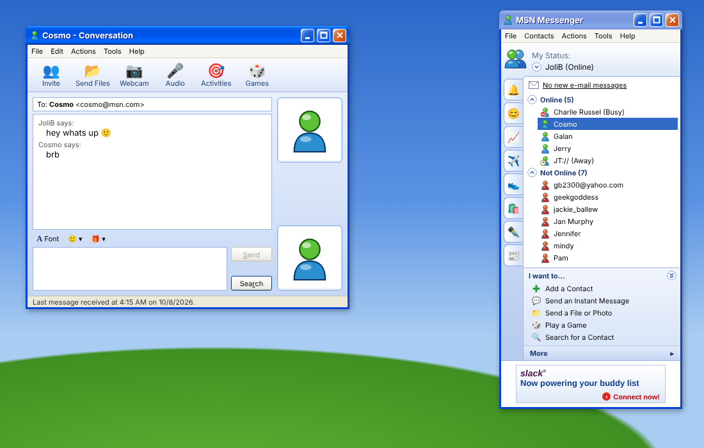

# mmi

MSN Messenger (6.x, Windows XP era) look-alike, backed by the Slack Web API.



```sh
npm install
npm run dev
```

With no token the app runs against an in-memory mock (`src/api/mockApi.ts`),
so the UI can be worked on offline. To use Slack, copy `.env.example` to
`.env` and set `VITE_SLACK_TOKEN` to a user token (`xoxp-…`). Proper app
authoring / OAuth is intentionally out of scope for now.

## Layout

```
src/
  api/           backend layer — the only code that knows about Slack
    types.ts       domain types + the MessengerApi interface
    slackClient.ts tiny Slack Web API caller
    slackApi.ts    MessengerApi on top of Slack
    mockApi.ts     MessengerApi in memory
    index.ts       picks one based on VITE_SLACK_TOKEN
  hooks/         React hooks over the api (polling)
  components/
    xp/            Windows XP primitives: Window, MenuBar, Menu, Button
    contacts/      the main contact list window
    chat/          the conversation window
    icons.tsx      buddy icons & friends, as inline SVG
  theme/         StyleX tokens
  App.tsx        "desktop" + window stacking
```

Styling is [StyleX](https://stylexjs.com) only (`src/index.css` is just a
reset + XP scrollbars). Note that StyleX drops `border`/`borderTop`-style
shorthands silently; use `borderWidth`/`borderStyle`/`borderColor`.

## How MSN maps onto Slack

| MSN                    | Slack                                                    |
| ---------------------- | -------------------------------------------------------- |
| Contact list           | workspace members (`users.list`), minus bots             |
| Online / Not Online    | `users.getPresence` (`active` / `away`)                  |
| Busy, Away, BRB, …     | custom status text/emoji (`users.profile.set`)           |
| Appear Offline         | `users.setPresence away`                                 |
| Conversation           | DM (`conversations.open`, `conversations.history`, `chat.postMessage`) |

Known shortcuts:

- Updates come from polling (contacts every 30s, open chats every 3s). Socket
  Mode / Events API would replace that once auth is sorted out.
- Presence is one request per member, so large workspaces will hit rate limits.
- Incoming messages only show up in already-open conversation windows.
